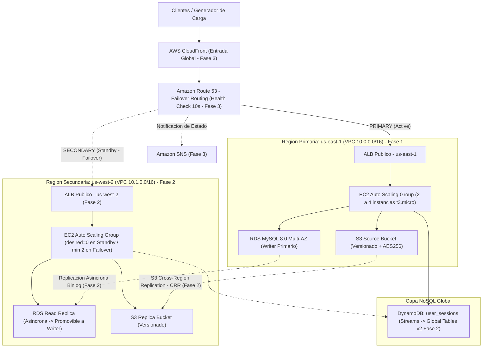
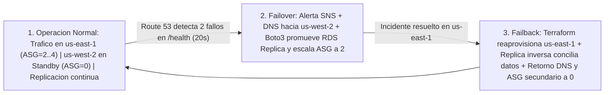

# Disaster Recovery Multi-Región en AWS (Warm Standby)

Diseño e implementación de una arquitectura de alta disponibilidad y recuperación ante desastres multi-región en **Amazon Web Services (AWS)** bajo el modelo **Warm Standby**, orientada a sistemas transaccionales con objetivos estrictos de continuidad operativa.

| Parámetro del Proyecto | Especificación |
| :--- | :--- |
| **Estrategia DR** | Warm Standby Multi-Región (`us-east-1` Activa / `us-west-2` Standby) |
| **RTO Objetivo** | `< 15 minutos` |
| **RPO Objetivo** | `< 5 minutos` |
| **Infraestructura como Código** | Terraform `>= 1.10.0` (Backend remoto S3 con `use_lockfile = true`) |
| **Carga de Validación** | API REST Transaccional (FastAPI, SQLAlchemy, PyMySQL, Boto3, Docker) |
| **Institución Académica** | Universidad Tecnológica de Bolívar (UTB) — Ingeniería de Sistemas |

---

## Estado de Implementación por Fases

| Fase | Alcance | Estado |
| :--- | :--- | :--- |
| **Fase 0 — Entorno y API** | API transaccional (`api/main.py`), Docker multi-stage, entorno local (`docker-compose.yml`), pipeline CI/CD y backend remoto S3. | **Completada (100%)** |
| **Fase 1 — Región Primaria (`us-east-1`)** | Módulos Terraform (`vpc`, `storage_s3`, `database_rds`, `compute_alb_asg`), tabla DynamoDB con Streams, harness `tests/test_api_connection.py` y plan validado (40 recursos). | **Codificada y Validada (100%)** |
| **Fase 2 — Warm Standby (`us-west-2`)** | Despliegue espejo con ASG en `desired_capacity = 0`, RDS Read Replica asíncrona, S3 CRR y DynamoDB Global Tables v2. | **Implementada (100%)** |
| **Fase 3 — Failover DNS y Boto3** | Módulo `route53_failover`, Health Checks globales, notificaciones SNS, SSM Parameter Store y `automation/failover_trigger.py`. | **Implementada (100%)** |
| **Fase 4 — Chaos Engineering y SLA** | Scripts de simulación end-to-end, pruebas de carga y medición de RTO/RPO, con calibración del `docs/runbook.md`. | **Lista para ejecución (100%)** |

---

## Arquitectura de la Solución

El diseño desacopla la **capa sin estado (cómputo)** de la **capa con estado (datos)**: la persistencia se mantiene sincronizada de forma continua entre regiones, mientras la capacidad de cómputo en `us-west-2` permanece preaprovisionada en `desired_capacity = 0` hasta que ocurre un failover.

### Topología Multi-Región (Warm Standby)



### Ciclo de Vida de Recuperación Multi-Región



---

## Justificación Técnica y Capa de Persistencia

* **¿Por qué Warm Standby?** *Backup & Restore* incumple `RTO < 15 min` por restauraciones lentas; *Pilot Light* introduce riesgo al aprovisionar instancias desde cero durante una crisis; *Hot Standby* duplica el costo de cómputo sin necesidad. **Warm Standby** logra el balance óptimo al mantener la capa de datos replicada y el entorno secundario listo para escalar.
* **Cobertura de tres patrones de persistencia:**

| Capa de Datos | Servicio AWS | Rol en el Caso de Uso | Mecanismo Multi-Región |
| :--- | :--- | :--- | :--- |
| **Relacional** | Amazon RDS MySQL 8.0 (`Multi-AZ`) | Registro transaccional e historial financiero (`transactions`) | Read Replica asíncrona en `us-west-2` con promoción a Writer |
| **NoSQL** | Amazon DynamoDB (`PAY_PER_REQUEST`) | Estado de sesión y carrito de compras (`user_sessions`) | Global Tables v2 activa-activa multi-maestro (Streams habilitados) |
| **Objetos** | Amazon S3 (`SSE-S3 AES256`, versionado) | Comprobantes digitales y facturas (`invoices/*.txt`) | S3 Cross-Region Replication (CRR) automática hacia `us-west-2` |

---

## Estructura del Repositorio

```text
DisasterRecovery-MultiRegion/
├── .github/
│   └── workflows/
│       └── terraform.yml                 # CI/CD: fmt check, init, validate, plan (PR) y apply (main)
├── api/
│   ├── Dockerfile                        # Imagen multi-stage Python 3.11-slim + HEALTHCHECK
│   ├── main.py                           # API REST transaccional (FastAPI, SQLAlchemy, Boto3)
│   └── requirements.txt                  # Dependencias Python (incluye cryptography para MySQL 8.0)
├── automation/
│   └── failover_trigger.py               # Orquestador Boto3 para promover RDS y escalar ASG (Fase 3)
├── docs/
│   ├── README.md                         # Índice maestro de documentación técnica
│   ├── arquitectura.md                   # Especificación de arquitectura, VPC, seguridad y ADRs
│   ├── regiones-y-replicacion.md         # Estrategia us-east-1 / us-west-2 y motores de datos
│   ├── api.md                            # Contrato de endpoints, esquemas Pydantic y Docker
│   ├── sistema-recovery-multiregion.md   # Flujos de failover, failback y Chaos Engineering
│   ├── iac-y-cicd.md                     # Módulos Terraform, backend S3, CI/CD, seguridad y costos
│   ├── pruebas-y-validacion.md           # Guía detallada de pruebas locales y end-to-end en AWS
│   ├── runbook.md                        # Manual de procedimientos operativos (SOP Failover/Failback)
│   └── estado_del_proyecto.md            # Informe de corte de avance por fases
├── terraform/
│   ├── environments/
│   │   ├── global/                       # Backend S3 (Route 53, CloudFront, Global Tables - Fase 3)
│   │   ├── primary_us_east_1/            # Infraestructura primaria en us-east-1 (40 recursos)
│   │   └── secondary_us_west_2/          # Backend S3 (Infraestructura Warm Standby - Fase 2)
│   └── modules/
│       ├── compute_alb_asg/              # ALB, Target Group (/health 10s), IAM/SSM, Launch Template, ASG
│       ├── database_rds/                 # RDS MySQL 8.0 Multi-AZ o Read Replica + Security Group
│       ├── route53_failover/             # Módulo reservado para DNS Failover y Health Checks (Fase 3)
│       ├── storage_s3/                   # Bucket S3 versionado, cifrado AES256 y bloqueo público
│       └── vpc/                          # VPC multi-tier en 2 AZs (pública, privada app, privada datos)
├── tests/
│   └── test_api_connection.py            # Suite end-to-end (6 verificaciones contra ALB o localhost)
└── docker-compose.yml                    # Entorno local (MySQL 8.0 en puerto 3307 + FastAPI en 8000)
```

---

## Ruta de Prueba y Uso

### Prerrequisitos

* **Pruebas locales:** Docker Engine / Docker Desktop, Docker Compose v2 y Python `3.11+` (`pip install requests`).
* **Despliegue en AWS:** Terraform `>= 1.10.0`, AWS CLI v2 con credenciales activas (`aws sts get-caller-identity`) y permisos sobre EC2, VPC, ALB, RDS, S3, DynamoDB e IAM.

### Opción 1: Ejecución y Pruebas Locales (Sin Costos AWS)

1. Construir y levantar los contenedores (`dr-local-mysql` en `3307:3306` y `dr-api-service` en `8000:8000`):

```bash
docker compose up --build -d
```

2. Abrir la documentación OpenAPI interactiva (Swagger UI) en `http://localhost:8000/docs` o verificar mediante CLI:

```bash
curl -s http://localhost:8000/health
curl -s -X POST http://localhost:8000/transaction \
  -H "Content-Type: application/json" \
  -d '{"user_id":"usr-local-01","amount":125.50,"description":"Prueba local MySQL"}'
curl -s http://localhost:8000/transactions/latest?limit=5
```

> **Nota sobre modo local:** `docker-compose.yml` configura credenciales ficticias (`mock_key` / `mock_secret`), por lo que MySQL 8.0 opera al 100% para `/health`, `/transaction` y `/transactions/latest`, mientras `/readiness`, `/cart` e `/invoice` requieren credenciales AWS válidas para conectar con DynamoDB y S3.

3. Detener el entorno local cuando finalicen las pruebas (`-v` limpia también el volumen de MySQL):

El sistema incluye una suite de pruebas con **Locust** ([locust.io](https://locust.io/)) para validar el comportamiento bajo estrés concurrente:

* **[tests/locustfile.py](tests/locustfile.py):** Modela usuarios virtuales que generan tráfico ponderado contra la API, auditando en cada respuesta la región que atendió la petición.
* **[tests/simulate_dr_end_to_end.py](tests/simulate_dr_end_to_end.py):**
  1. Inicia un Gateway Global multi-región con `us-east-1` activo y `us-west-2` en Warm Standby.
  2. Lanza Locust con 25 usuarios concurrentes.
  3. En $t = +7\text{s}$, inyecta la caída de `us-east-1` (`HTTP 503`).
  4. Dispara automáticamente `failover_trigger.py`, promueve RDS y escala el ASG secundario a 2 instancias.
  5. Conmuta el tráfico a `us-west-2` y exporta el reporte gráfico interactivo a [`docs/locust_dr_report.html`](docs/locust_dr_report.html).

---

## 9. Guía de Ejecución y Despliegue

### 9.1 Simulación End-to-End con Locust
```bash
pip install -r tests/requirements.txt
python tests/simulate_dr_end_to_end.py
```
*Genera el reporte HTML interactivo en [`docs/locust_dr_report.html`](docs/locust_dr_report.html).*

### 9.2 Interfaz Gráfica Web de Locust
```bash
locust -f tests/locustfile.py --host http://localhost:8000
```
*Abrir `http://localhost:8089` para lanzar usuarios y ver las gráficas en tiempo real.*

### 9.3 Entorno Local con Docker Compose
```bash
docker compose down -v
```

### Opción 2: Despliegue y Validación End-to-End en AWS (Fase 1 - `us-east-1`)

1. Inicializar, validar y planificar la infraestructura primaria:

```bash
terraform -chdir=terraform/environments/primary_us_east_1 init
terraform -chdir=terraform/environments/primary_us_east_1 validate
terraform -chdir=terraform/environments/primary_us_east_1 plan -out=tfplan
```

2. Aplicar el despliegue en AWS (tiempo aproximado de aprovisionamiento RDS Multi-AZ y NAT Gateway: 10–15 minutos, más 3–5 minutos de arranque de User Data en EC2):

```bash
terraform -chdir=terraform/environments/primary_us_east_1 apply tfplan
```

3. Obtener el DNS del Application Load Balancer y ejecutar la suite de validación end-to-end (6 chequeos sobre ALB, `/readiness`, RDS, DynamoDB y S3):

```bash
terraform -chdir=terraform/environments/primary_us_east_1 output -raw alb_dns_name
python tests/test_api_connection.py --url http://<ALB_DNS_NAME>
```

4. Destruir los recursos temporales al finalizar las pruebas de laboratorio para resguardar créditos de AWS:

```bash
terraform -chdir=terraform/environments/primary_us_east_1 destroy -auto-approve
```

---

## Endpoints de la API Transaccional

| Método y Ruta | Código Éxito | Capa / Servicio | Propósito |
| :--- | :---: | :--- | :--- |
| `GET /health` | `200` | Cómputo (ALB / Route 53) | Health check liviano con región activa y timestamp UTC |
| `GET /readiness` | `200` | RDS + DynamoDB + S3 | Diagnóstico profundo de conectividad hacia las 3 capas |
| `POST /transaction` | `201` | RDS MySQL 8.0 | Registra una transacción financiera con UUID y región |
| `GET /transactions/latest` | `200` | RDS MySQL 8.0 | Consulta transacciones recientes para auditoría de RPO |
| `POST /cart` | `200` | DynamoDB (`user_sessions`) | Crea o actualiza estado de carrito de compras |
| `GET /cart/{user_id}` | `200` | DynamoDB (`user_sessions`) | Verifica lectura y propagación de sesiones |
| `POST /invoice` | `201` | Amazon S3 | Sube comprobante `.txt` con metadatos y `VersionId` |
| `GET /invoice/{invoice_id}` | `200` | Amazon S3 | Consulta metadatos y existencia vía `head_object` |

---

## Documentación Técnica Detallada

| Documento | Contenido |
| :--- | :--- |
| [docs/README.md](docs/README.md) | Índice maestro, guía por perfil y trazabilidad con criterios de evaluación |
| [docs/arquitectura.md](docs/arquitectura.md) | Justificación de Warm Standby, topología VPC, Security Groups y ADRs |
| [docs/regiones-y-replicacion.md](docs/regiones-y-replicacion.md) | Diseño `us-east-1` / `us-west-2`, CIDRs y replicación RDS / DynamoDB / S3 |
| [docs/api.md](docs/api.md) | Especificación completa de endpoints, SQLAlchemy, esquemas Pydantic y Dockerfile |
| [docs/sistema-recovery-multiregion.md](docs/sistema-recovery-multiregion.md) | Flujos de failover, failback, Route 53, Boto3 y Chaos Engineering (AWS FIS) |
| [docs/iac-y-cicd.md](docs/iac-y-cicd.md) | Catálogo de módulos Terraform, backend remoto S3, GitHub Actions y seguridad |
| [docs/pruebas-y-validacion.md](docs/pruebas-y-validacion.md) | Guía paso a paso de pruebas en Docker Compose y AWS |
| [docs/runbook.md](docs/runbook.md) | Procedimientos Operativos Estándar (SOP-01 Failover / SOP-02 Failback) |
| [docs/estado_del_proyecto.md](docs/estado_del_proyecto.md) | Informe de estado por fases (corte octubre de 2026) |

---

## Equipo de Trabajo

| Integrante | Código UTB | Rol en el Proyecto |
| :--- | :---: | :--- |
| **Joel David Gonzalez Barros** | `T00078571` | DevOps Lead & Core IaC |
| **Álvaro Jesús Ayala Alcala** | `T00078312` | Database & Persistence Engineer |
| **Maykol Stiven Madrid Romero** | `T00078588` | Compute & Networking Specialist |
| **Diego Peña Paez** | `T00067812` | SRE & Automation Engineer |

*Asignatura: Infraestructura como Código & DevOps — Docente: Rafael Enrique Monterroza Barrios — Universidad Tecnológica de Bolívar.*
