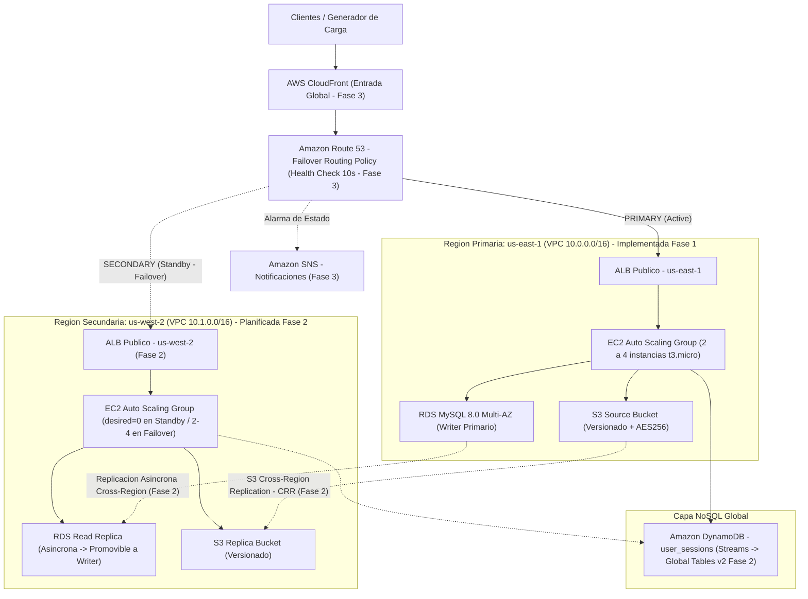
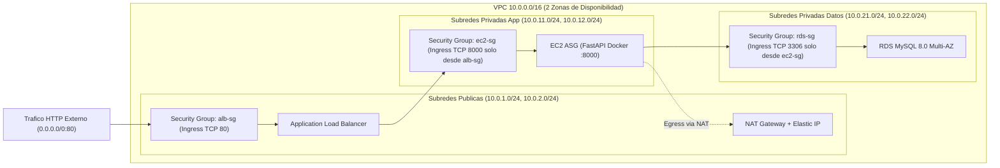
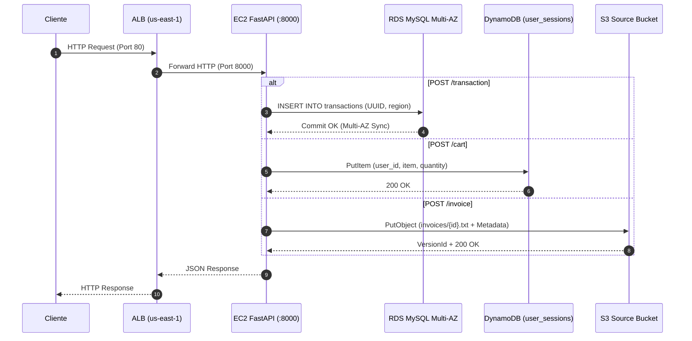

# Especificación y Justificación de Arquitectura

**Estado del documento:** Vigente para Fase 1 (diseño global validado; región primaria implementada en Terraform).  
**Estrategia:** Disaster Recovery Multi-Región bajo modelo **Warm Standby**.  
**Objetivos de Nivel de Servicio (SLA):** `RTO < 15 minutos` | `RPO < 5 minutos`.

---

## 1. Contexto y Requisitos No Funcionales

Los sistemas transaccionales desplegados en una única región de nube pública están expuestos a fallos de plano de control, degradación masiva de servicios regionales, errores humanos de configuración o incidentes externos de infraestructura. Para garantizar la continuidad operativa, el diseño de esta arquitectura parte de tres requisitos no funcionales:

1. **Recovery Time Objective (RTO) < 15 minutos:** Tiempo máximo tolerable entre la detección de una caída regional en `us-east-1` y el restablecimiento completo de la capacidad de procesamiento en `us-west-2`.
2. **Recovery Point Objective (RPO) < 5 minutos:** Ventana máxima aceptable de pérdida de datos transaccionales ante un fallo abrupto e irrecuperable de la región primaria.
3. **Eficiencia de Costos en Operación Normal:** Evitar el mantenimiento de capacidad de cómputo ociosa duplicada en la región de respaldo durante la operación estable.

Para validar cuantitativamente estos objetivos, se diseñó un caso de uso transaccional mínimo que ejercita de manera simultánea tres motores de persistencia distintos (relacional, NoSQL y almacenamiento de objetos).

---

## 2. Análisis Comparativo de Estrategias de Disaster Recovery

De acuerdo con el *AWS Well-Architected Framework*, existen cuatro patrones principales para Disaster Recovery. El análisis conceptual frente al SLA exigido determina la adopción de **Warm Standby**:

| Estrategia DR | Estado del Cómputo en Standby | Estado de Datos en Standby | RTO Típico | RPO Típico | Costo Relativo | Decisión |
| :--- | :--- | :--- | :--- | :--- | :--- | :--- |
| **Backup & Restore** | Inexistente (aprovisionamiento total bajo demanda) | Snapshots y backups periódicos en S3 | Horas | Horas | Muy bajo | **Descartado:** incompatible con `RTO < 15 min` y `RPO < 5 min`. |
| **Pilot Light** | Sin infraestructura de cómputo desplegada o mínima apagada | Datos sincronizados de forma continua | Decenas de minutos | Segundos a minutos | Bajo | **Descartado:** el aprovisionamiento desde cero de instancias y su registro bajo carga real compromete el margen de 15 minutos. |
| **Warm Standby** | Infraestructura de red, ALB y Launch Template listos; ASG en `desired_capacity = 0` | Datos sincronizados de forma continua (Read Replica, CRR, Global Tables) | **< 15 minutos** | **< 5 minutos** | **Moderado** | **Adoptado:** equilibrio óptimo entre costo operativo y cumplimiento automatizable del SLA. |
| **Hot Standby (Active-Active)** | Capacidad de cómputo completa ejecutándose permanentemente | Replicación síncrona o activa-activa continua | Segundos a < 1 min | Casi cero | Muy alto | **Descartado:** duplica costos de cómputo e infraestructura sin justificación frente al SLA requerido. |

### Justificación Técnica de Warm Standby

El modelo adoptado desacopla la **capa sin estado (stateless)** de la **capa con estado (stateful)**:
- **Capa Stateful (Datos):** Permanece sincronizada continuamente entre `us-east-1` y `us-west-2` porque la restauración masiva de datos es la operación más lenta durante un desastre.
- **Capa Stateless (Cómputo):** La VPC, los Security Groups, el Application Load Balancer (ALB) y el Auto Scaling Group (ASG) con su Launch Template quedan preaprovisionados en `us-west-2`, pero con `desired_capacity = 0` instancias EC2 en ejecución. Durante un failover solo se requiere promover la réplica de base de datos y escalar el ASG, operaciones completamente automatizables dentro de la ventana de 15 minutos.

---

## 3. Arquitectura General Multi-Región

El siguiente diagrama representa la topología completa diseñada para el sistema (indicando los componentes desplegados en Fase 1 y los proyectados para Fases 2 y 3):

---

## 4. Arquitectura de Red y Segmentación (`modules/vpc`)

Cada región utiliza una VPC aislada dividida en **3 niveles de subredes** distribuidos en **2 Zonas de Disponibilidad (AZ)** para garantizar alta disponibilidad intra-regional y aislamiento de tráfico.

### 4.1. Distribución de Subredes en `us-east-1` (`10.0.0.0/16`)

| Nivel (Tier) | Subredes (AZ1 / AZ2) | Tabla de Ruteo | Conectividad Saliente | Recursos Alojados |
| :--- | :--- | :--- | :--- | :--- |
| **Público** | `10.0.1.0/24`, `10.0.2.0/24` | `public-rt` (`0.0.0.0/0` -> IGW) | Bidireccional a Internet | Application Load Balancer, NAT Gateway (`public[0]`) |
| **Privado de Aplicación** | `10.0.11.0/24`, `10.0.12.0/24` | `private-app-rt` (`0.0.0.0/0` -> NAT GW) | Solo saliente (descarga Docker/Git/SSM/AWS APIs) | Instancias EC2 del ASG (`associate_public_ip_address = false`) |
| **Privado de Datos** | `10.0.21.0/24`, `10.0.22.0/24` | `private-data-rt` (sin ruta `0.0.0.0/0`) | Sin acceso a Internet | DB Subnet Group de RDS MySQL Multi-AZ |

### 4.2. Topología Interna y Cascada de Security Groups

### 4.3. Controles de Seguridad por Capa

1. **Perímetro HTTP:** Las instancias EC2 no poseen IP pública (`associate_public_ip_address = false`). Únicamente aceptan tráfico en el puerto `8000` proveniente del Security Group del ALB (`aws_security_group.alb.id`).
2. **Aislamiento de Base de Datos:** RDS MySQL tiene `publicly_accessible = false`, reside en `private_data` sin ruta a Internet y su Security Group restringe el puerto `3306` exclusivamente al Security Group de las instancias EC2 (`var.app_security_group_id`).
3. **Acceso sin Llaves SSH:** El rol IAM de EC2 (`aws_iam_role.ec2`) adjunta la política administrada `AmazonSSMManagedInstanceCore`, permitiendo administración remota segura mediante AWS Systems Manager Session Manager sin exponer el puerto 22.
4. **Almacenamiento S3 Cerrado:** El módulo `storage_s3` aplica `aws_s3_bucket_public_access_block` con sus cuatro directivas activadas (`block_public_acls`, `block_public_policy`, `ignore_public_acls`, `restrict_public_buckets`) y cifrado en reposo SSE-S3 (`AES256`).

---

## 5. Flujo de Procesamiento de una Petición (Estado Normal)

---

## 6. Registro de Decisiones de Arquitectura (ADR)

| ID | Decisión | Contexto y Justificación |
| :--- | :--- | :--- |
| **ADR-01** | **Uso de RDS MySQL 8.0 Multi-AZ + `backup_retention_period = 7`** | Multi-AZ provee alta disponibilidad síncrona dentro de `us-east-1`; la retención de backups mayor a 0 días es requisito estricto de AWS para habilitar Cross-Region Read Replicas en Fase 2. |
| **ADR-02** | **Inclusión de `cryptography>=42.0.0` y `pool_pre_ping=True` en FastAPI** | MySQL 8.0 en AWS RDS utiliza por defecto el plugin de autenticación `caching_sha2_password` (que exige `cryptography` en PyMySQL). `pool_pre_ping=True` detecta conexiones rotas tras un failover de RDS antes de ejecutar consultas. |
| **ADR-03** | **Propiedad `ignore_changes = [desired_capacity]` en el ASG** | Evita que ejecuciones posteriores de `terraform apply` reviertan a `0` las instancias escaladas dinámicamente por `failover_trigger.py` o políticas de autoescalado durante una contingencia. |
| **ADR-04** | **Backend remoto S3 con `use_lockfile = true` (Terraform `>= 1.10.0`)** | Elimina la dependencia de tablas DynamoDB externas exclusivamente para bloqueo de estado de Terraform, simplificando el bootstrap del estado remoto y aislando `primary`, `secondary` y `global`. |
| **ADR-05** | **Migración planificada de secretos a SSM Parameter Store (Fase 3)** | En Fase 1 la cadena de conexión se inyecta mediante User Data en el Launch Template; en Fase 3 las instancias obtendrán credenciales dinámicamente desde AWS SSM Parameter Store para evitar exposición en metadatos del Launch Template. |
