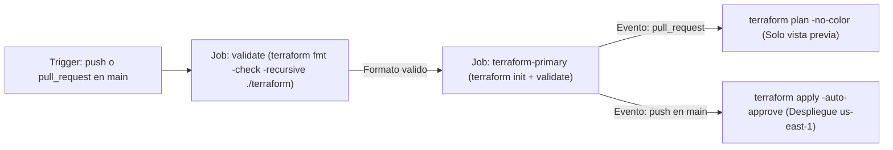

# Infraestructura como Código (Terraform), CI/CD y Gobernanza

**Versión de Terraform requerida:** `>= 1.10.0` (CI/CD ejecutando `1.10.5`)  
**Proveedores:** `hashicorp/aws (~> 5.0)`, `hashicorp/random (~> 3.5)`

---

## 1. Arquitectura Modular de Terraform

El código IaC en `terraform/` se divide en **módulos reutilizables** (para desplegar infraestructura espejo entre `us-east-1` y `us-west-2` sin duplicar lógica) y **entornos aislados** con estados remotos independientes.

### 1.1. Catálogo de Módulos (`terraform/modules/`)

| Módulo | Recursos Principales | Entradas Clave | Salidas Clave | Estado |
| :--- | :--- | :--- | :--- | :--- |
| `vpc` | VPC, IGW, 2 subredes públicas, 2 privadas App, 2 privadas Data, EIP, NAT GW, 3 tablas de ruteo | `vpc_cidr`, `public_subnet_cidrs`, `private_app_subnet_cidrs`, `private_data_subnet_cidrs` | `vpc_id`, `public_subnet_ids`, `private_app_subnet_ids`, `private_data_subnet_ids`, `nat_gateway_id` | **Implementado** |
| `storage_s3` | `aws_s3_bucket`, `versioning`, `server_side_encryption_configuration` (`AES256`), `public_access_block` | `bucket_name`, `enable_versioning`, `enable_force_destroy` | `bucket_id`, `bucket_arn`, `bucket_name` | **Implementado** |
| `database_rds` | `aws_db_subnet_group`, `aws_security_group` (3306 desde EC2), `aws_db_instance` (Writer Multi-AZ o Read Replica) | `instance_class`, `multi_az`, `backup_retention_period`, `is_read_replica`, `replicate_source_db` | `db_instance_id`, `db_instance_arn`, `db_endpoint`, `db_address`, `db_port` | **Implementado** |
| `compute_alb_asg` | Security Groups (`alb`, `ec2`), ALB, Target Group (`/health` cada 10s), Listener 80, IAM Role/Profile, Launch Template (AL2023 + Docker), ASG | `min_size`, `max_size`, `desired_capacity`, `app_port`, `db_host`, `dynamo_table`, `s3_bucket` | `alb_dns_name`, `alb_arn`, `alb_zone_id`, `target_group_arn`, `asg_name`, `ec2_security_group_id` | **Implementado** |
| `route53_failover` | Health Checks Route 53, registros DNS con política Failover (`PRIMARY` / `SECONDARY`), alertas SNS | — | — | **Pendiente (Fase 3)** |

### 1.2. Entornos Desplegables (`terraform/environments/`)

| Entorno | Ruta | Propósito | Estado |
| :--- | :--- | :--- | :--- |
| **Primario (`us-east-1`)** | `terraform/environments/primary_us_east_1/` | Despliega `vpc`, `storage_s3`, `aws_dynamodb_table.user_sessions`, `database_rds` y `compute_alb_asg` (**40 recursos planificados**). | **Codificado y validado** |
| **Secundario (`us-west-2`)** | `terraform/environments/secondary_us_west_2/` | Despliegue espejo con `vpc_cidr = "10.1.0.0/16"`, `desired_capacity = 0`, `is_read_replica = true`, S3 CRR y réplica DynamoDB. | **Backend listo; pendiente Fase 2** |
| **Global** | `terraform/environments/global/` | CloudFront, Route 53 Failover Routing, Health Checks globales y tópicos SNS. | **Backend listo; pendiente Fase 3** |

---

## 2. Gestión de Estado Remoto (Backend S3)

Cada entorno almacena su archivo `.tfstate` en una ruta aislada dentro del bucket S3 `dr-proyecto-terraform-state-utb` en `us-east-1`, evitando que un error o bloqueo en una región afecte el estado de otra:

| Entorno | Archivo `backend.tf` | Key en S3 | Bloqueo y Cifrado |
| :--- | :--- | :--- | :--- |
| `primary_us_east_1` | `primary/terraform.tfstate` | `primary/terraform.tfstate` | `use_lockfile = true`, `encrypt = true` |
| `secondary_us_west_2` | `secondary/terraform.tfstate` | `secondary/terraform.tfstate` | `use_lockfile = true`, `encrypt = true` |
| `global` | `global/terraform.tfstate` | `global/terraform.tfstate` | `use_lockfile = true`, `encrypt = true` |

> La directiva `use_lockfile = true` requiere Terraform `>= 1.10.0` para gestionar el archivo `.tflock` nativamente en S3 sin requerir una tabla DynamoDB separada para locks.

---

## 3. Pipeline CI/CD (`.github/workflows/terraform.yml`)

El flujo de integración y entrega continua en GitHub Actions se ejecuta en cada `push` y `pull_request` hacia la rama `main`:



* **Versión fijada en runner:** `TERRAFORM_VERSION: "1.10.5"` con `actions/checkout@v4` y `hashicorp/setup-terraform@v3`.
* **Secretos requeridos en GitHub:** `AWS_ACCESS_KEY_ID` y `AWS_SECRET_ACCESS_KEY`.
* **Expansión prevista:** En Fases 2 y 3 se añadirán los jobs equivalentes para `secondary_us_west_2` y `global` manteniendo `validate` como compuerta común.

---

## 4. Gobernanza de Seguridad y Mejoras Planificadas

Durante la revisión técnica del código de Fase 1 se identifican controles ya implementados y puntos de endurecimiento (*hardening*) programados para las fases siguientes:

| Aspecto | Implementación Actual (Fase 1) | Acción de Endurecimiento (Fases 2–4 / Producción) |
| :--- | :--- | :--- |
| **Credenciales RDS** | `var.db_password` tiene valor por defecto en `variables.tf` y se inyecta en User Data. | Sobrescribir mediante `TF_VAR_db_password` en CI/CD y migrar lectura a **AWS SSM Parameter Store** (`SecureString`) en Fase 3. |
| **Permisos IAM EC2** | `app_permissions` otorga acciones acotadas de DynamoDB/S3 con `Resource = "*"`. | Restringir `Resource` al ARN exacto de la tabla `user_sessions` y los buckets S3 origen/réplica. |
| **Tráfico HTTP/TLS** | Listener del ALB en puerto `80` (`HTTP`). | Incorporar **AWS CloudFront** con TLS en borde y/o certificado ACM en ALB para tráfico HTTPS extremo a extremo. |
| **Protección contra borrado** | `deletion_protection = false`, `skip_final_snapshot = true`, `enable_force_destroy = true`. | Configurado intencionalmente para permitir `terraform destroy` limpio en laboratorio académico; cambiar a `true`/`false` según corresponda en producción. |

---

## 5. Control de Costos en Laboratorio

Los principales recursos con cobro continuo por hora en `primary_us_east_1` son:
1. **Amazon RDS MySQL Multi-AZ (`db.t3.micro`):** Factura doble instancia (primaria + standby síncrona).
2. **NAT Gateway + Elastic IP:** Cargo fijo por hora de aprovisionamiento y por GB procesado.
3. **Application Load Balancer + 2 instancias EC2 `t3.micro`:** Costo continuo mientras el ASG mantenga `desired_capacity = 2`.

Para optimizar créditos de AWS fuera de sesiones de prueba, destruir el entorno mediante:
```bash
terraform -chdir=terraform/environments/primary_us_east_1 destroy -auto-approve
```
El modelo **Warm Standby** en `us-west-2` mantiene el ASG en `desired_capacity = 0`, evitando costos de cómputo EC2 en la región secundaria mientras no ocurra un failover.
