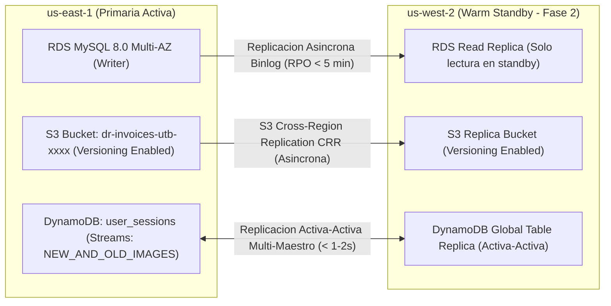

# Estrategia Multi-Región y Capa de Persistencia

**Estado del documento:** Implementación completa de regiones y motores de persistencia; lista para despliegue y validación con `tests/test_replication_fase2.py`.

---

## 1. Selección y Justificación de Regiones AWS

La arquitectura opera sobre un par de regiones geográficamente distantes dentro de los Estados Unidos para maximizar la independencia ante fallos eléctricos, climáticos o de fibra regional, manteniendo un direccionamiento IP no superpuesto.

| Rol | Región AWS | Ubicación | Bloque CIDR VPC | Estado Actual | Justificación |
| :--- | :--- | :--- | :--- | :--- | :--- |
| **Primaria (Active)** | `us-east-1` | N. Virginia | `10.0.0.0/16` | **Implementada (Fase 1)** | Región de referencia con mayor disponibilidad de servicios, menor latencia hacia planos de control globales (IAM, Route 53, CloudFront) y costo óptimo para instancias `t3.micro` y `db.t3.micro`. |
| **Secundaria (Warm Standby)** | `us-west-2` | Oregón | `10.1.0.0/16` | **Implementada** | Separación transcontinental respecto a la costa este (aprox. 3,800 km), eliminando correlación ante desastres físicos o fallos regionales masivos de la costa este. |

### Diseño de Direccionamiento IP Sin Solapamiento

| Región | VPC CIDR | Subredes Públicas (ALB / NAT) | Subredes Privadas App (EC2) | Subredes Privadas Datos (RDS) |
| :--- | :--- | :--- | :--- | :--- |
| `us-east-1` | `10.0.0.0/16` | `10.0.1.0/24`, `10.0.2.0/24` | `10.0.11.0/24`, `10.0.12.0/24` | `10.0.21.0/24`, `10.0.22.0/24` |
| `us-west-2` (Fase 2) | `10.1.0.0/16` | `10.1.1.0/24`, `10.1.2.0/24` | `10.1.11.0/24`, `10.1.12.0/24` | `10.1.21.0/24`, `10.1.22.0/24` |

Mantener rangos `/16` disjuntos (`10.0.0.0/16` frente a `10.1.0.0/16`) permite establecer VPC Peering o AWS Transit Gateway sin conflictos de enrutamiento en caso de requerir comunicación privada directa durante procesos de migración o failback.

---

## 2. Arquitectura de Replicación por Capa de Persistencia

La especificación técnica exige validar tres modelos de datos distintos. Cada uno responde a un patrón de consistencia, latencia de propagación (RPO) y procedimiento de activación diferente durante un desastre.

---

## 3. Especificación Detallada por Servicio

### 3.1. Capa Relacional: Amazon RDS MySQL 8.0

* **Caso de uso:** Registro estricto de transacciones financieras e historial auditable (`POST /transaction`, `GET /transactions/latest`).
* **Configuración implementada en Fase 1 (`modules/database_rds/`):**
  * Motor: `mysql` versión `8.0`, clase `db.t3.micro`.
  * Almacenamiento: `20 GB` tipo `gp3` con autoescalado hasta `100 GB`.
  * Alta disponibilidad intra-regional: `multi_az = true` (réplica síncrona en segunda AZ dentro de `us-east-1`).
  * Retención de backups: `backup_retention_period = 7` días (habilitador obligatorio en AWS para crear Read Replicas cross-region).
  * Aislamiento: `publicly_accessible = false`, desplegado en `private_data` con Security Group limitado al puerto `3306` desde `ec2-sg`.
* **Comportamiento multi-región (Fase 2 y Failover en Fase 3):**
  * El módulo `database_rds` ya soporta los parámetros `is_read_replica = true` y `replicate_source_db = <rds_arn_primario>`, omitiendo automáticamente `engine`, `db_name`, `username`, `password`, `multi_az` y `backup_retention_period = 0` cuando actúa como réplica.
  * Durante operación normal, la réplica en `us-west-2` recibe cambios asíncronos mediante replicación binaria de MySQL y permanece en modo solo lectura.
  * Ante un failover, `automation/failover_trigger.py` ejecuta la promoción de la Read Replica (`promote-read-replica`), convirtiéndola en una instancia independiente de lectura y escritura para atender a la API en `us-west-2`.

### 3.2. Capa NoSQL: Amazon DynamoDB

* **Caso de uso:** Estado de sesión de usuario y carrito de compras de baja latencia (`POST /cart`, `GET /cart/{user_id}`).
* **Configuración implementada en Fase 1 (`environments/primary_us_east_1/main.tf`):**
  * Tabla: `user_sessions`.
  * Capacidad: `PAY_PER_REQUEST` (bajo demanda, evita costos fijos de capacidad aprovisionada).
  * Clave primaria (`hash_key`): `user_id` (tipo `S`).
  * Streams: `stream_enabled = true` con `stream_view_type = "NEW_AND_OLD_IMAGES"` (prerrequisito técnico para Global Tables).
* **Comportamiento multi-región (Fase 2):**
  * Se agrega la réplica en `us-west-2` convirtiendo `user_sessions` en una **DynamoDB Global Table v2**.
  * Funciona bajo topología **activa-activa multi-maestro**: cualquier región puede leer y escribir de inmediato con propagación típica en sub-segundos o pocos segundos, sin necesidad de promoción manual durante un failover.

### 3.3. Capa de Objetos: Amazon S3

* **Caso de uso:** Almacenamiento inmutable de comprobantes digitales y facturas (`POST /invoice`, `GET /invoice/{invoice_id}`).
* **Configuración implementada en Fase 1 (`modules/storage_s3/`):**
  * Nomenclatura: `dr-invoices-utb-<random_id>` (sufijo de 4 bytes hexadecimales para unicidad global).
  * Versionado: `aws_s3_bucket_versioning` en estado `Enabled` (requisito obligatorio de AWS para S3 Cross-Region Replication).
  * Cifrado en reposo: SSE-S3 (`AES256`).
  * Acceso público: Bloqueado en su totalidad mediante `aws_s3_bucket_public_access_block`.
* **Comportamiento multi-región (Fase 2):**
  * Se crea un bucket destino en `us-west-2` con versionado habilitado y una regla de **S3 Cross-Region Replication (CRR)** asociada a un rol IAM que replica automáticamente cada objeto nuevo (`invoices/*`) y sus metadatos desde `us-east-1` hacia `us-west-2`.

---

## 4. Matriz Resumen de Replicación y RPO Esperado

| Capa | Servicio AWS | Mecanismo Intra-Región | Mecanismo Cross-Región | RPO Conceptual Esperado | Acción Requerida en Failover |
| :--- | :--- | :--- | :--- | :--- | :--- |
| **Relacional** | RDS MySQL 8.0 | Multi-AZ (Síncrono) | Read Replica (Asíncrono) | Segundos a < 5 min (según `ReplicaLag`) | Promover Read Replica a Writer independiente |
| **NoSQL** | DynamoDB | Replicación nativa en 3 AZs | Global Tables v2 (Activa-Activa) | Segundos (tiempo cercano al real) | Ninguna (endpoint regional inmediato) |
| **Objetos** | Amazon S3 | Durabilidad 11 novenos en múltiples AZs | Cross-Region Replication (CRR) | Segundos a minutos | Apuntar variable `S3_BUCKET` al bucket réplica de `us-west-2` |

> **Nota sobre verificación empírica:** Los valores reales de `ReplicaLag` y RPO efectivo bajo carga continua se medirán en la Fase 4 mediante pruebas controladas de Chaos Engineering y auditoría de registros en `/transactions/latest`.
