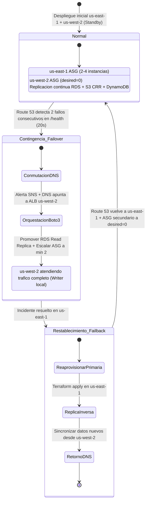
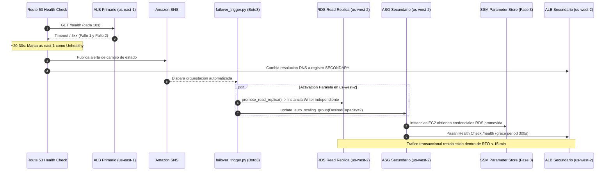

# Sistema de Recovery Multi-Región (Failover, Failback y Chaos Engineering)

**Estado del documento:** Implementación completa. Route 53, CloudFront, SNS y `automation/failover_trigger.py` están listos; las pruebas reales de chaos y medición RTO/RPO deben ejecutarse durante el despliegue en AWS.

---

## 1. Modelo Operativo de Tres Estados

El comportamiento del sistema ante desastres se rige por una máquina de estados finitos con tres fases claramente definidas: **Normal**, **Contingencia (Failover)** y **Restablecimiento (Failback)**.

---

## 2. Estado 1: Operación Normal (Estable)

* **Tráfico global:** CloudFront y Route 53 dirigen el 100% de las peticiones al ALB público de `us-east-1`.
* **Cómputo:**
  * `us-east-1`: ASG operando con `min_size = 2`, `max_size = 4`, `desired_capacity = 2`.
  * `us-west-2`: ALB y Launch Template creados, pero ASG con `desired_capacity = 0` (costo de cómputo EC2 igual a cero en standby).
* **Health Checks activos:**
  * El Target Group del ALB en `modules/compute_alb_asg` evalúa `GET /health` cada `10` segundos (`timeout = 5s`, `healthy_threshold = 2`, `unhealthy_threshold = 2`, `matcher = "200"`).
  * Route 53 (Fase 3) monitorizará el ALB primario cada `10` segundos.
* **Replicación continua:**
  * RDS `us-east-1` -> RDS Read Replica `us-west-2` (asíncrona).
  * S3 `us-east-1` -> S3 Replica `us-west-2` (CRR).
  * DynamoDB Global Tables `user_sessions` (activa-activa).

---

## 3. Estado 2: Contingencia y Failover (`us-east-1` -> `us-west-2`)

El failover se ejecuta cuando la región primaria queda inaccesible o su endpoint `/health` falla de manera sostenida.

### 3.1. Flujo de Secuencia del Failover (Fases 3 y 4)

### 3.2. Detalles Críticos de Orquestación (`automation/failover_trigger.py` - Fase 3)

1. **Promoción de RDS Read Replica:**
   * Se invoca la API `promote_read_replica` de Boto3 sobre la réplica en `us-west-2`.
   * La réplica rompe la relación de replicación con `us-east-1` (previniendo conflictos *split-brain*) y se convierte en una base de datos primaria de lectura y escritura.
2. **Escalado del ASG Secundario:**
   * Se actualiza `desired_capacity` de `0` a un mínimo de `2` instancias en `us-west-2`.
   * El módulo `compute_alb_asg` ya incluye `lifecycle { ignore_changes = [desired_capacity] }` para que Terraform no sobrescriba este cambio operativo en futuros despliegues.
3. **Actualización de Configuración / Secretos:**
   * Las instancias nuevas en `us-west-2` deben apuntar al endpoint de la RDS promovida y al bucket S3 réplica. El diseño contempla el uso de **AWS SSM Parameter Store** para desacoplar las credenciales y el host de base de datos del Launch Template estático.

### 3.3. Presupuesto de Tiempo Estimado Frente al SLA (`RTO < 15 min`)

| Etapa del Failover | Tiempo Estimado (Referencial) | Responsable |
| :--- | :--- | :--- |
| Detección de falla (2 intervalos de 10s + timeout) | ~25 - 30 segundos | Route 53 Health Check |
| Propagación DNS (TTL bajo en registro Failover) + Alerta SNS | ~30 - 60 segundos | Route 53 + SNS |
| Arranque EC2 (`t3.micro`), Docker build/start y registro en ALB | ~3 - 5 minutos | EC2 ASG + User Data |
| Promoción de RDS Read Replica (`db.t3.micro`) a Writer | ~3 - 6 minutos | AWS RDS Control Plane |
| **Total conceptual estimado** | **~6 - 10 minutos** | **Margen positivo frente a RTO < 15 min** |

> La medición empírica exacta se obtendrá en la Fase 4; usar una imagen AMI pre-construida o ECR pre-almacenado es una palanca de optimización identificada si `docker build` en User Data consumiera tiempo excesivo durante las pruebas.

---

## 4. Estado 3: Restablecimiento / Failback (`us-west-2` -> `us-east-1`)

Una vez superado el incidente en la región primaria, el retorno a `us-east-1` requiere cuidado especial porque durante la contingencia `us-west-2` recibió escrituras nuevas en RDS (instancia promovida), S3 y DynamoDB.

1. **Reaprovisionamiento en `us-east-1`:** Ejecutar `terraform apply` en `environments/primary_us_east_1` para reconstruir o verificar la integridad de VPC, ALB, ASG y RDS.
2. **Sincronización Inversa de Datos:**
   * **RDS:** Establecer una réplica temporal o restauración desde `us-west-2` hacia `us-east-1` para transferir las transacciones ocurridas durante la contingencia (evitando sobrescribir con datos viejos).
   * **DynamoDB:** Al operar con Global Tables activa-activa, los cambios escritos en `us-west-2` se propagan automáticamente al restablecerse `us-east-1`.
   * **S3:** Configurar sincronización o replicación inversa temporal para los comprobantes emitidos en `us-west-2` durante el incidente.
3. **Corte Controlado de Tráfico:**
   * Verificar `/readiness` en `us-east-1` (`rds_mysql`, `dynamodb`, `s3` en estado `connected`).
   * Restablecer la ruta primaria en Route 53 hacia el ALB de `us-east-1`.
   * Restablecer el flujo normal de replicación (`us-east-1` -> `us-west-2`) y reducir el ASG secundario nuevamente a `desired_capacity = 0`.

---

## 5. Estrategia de Chaos Engineering y Medición (Fase 4)

En la Fase 4 se validará el cumplimiento real del SLA mediante **AWS Fault Injection Service (FIS)** y un generador de carga continuo contra la API:

1. **Escenarios de prueba:**
   * **Escenario A:** Terminación/aislamiento forzado de instancias del ASG y/o bloqueo de tráfico al ALB primario.
   * **Escenario B:** Simulación de indisponibilidad de la instancia RDS primaria en `us-east-1`.
2. **Cálculo de métricas:**
   * **RTO Real:** `T_recuperacion - T_fallo`, donde `T_fallo` es el último código `200 OK` en `us-east-1` antes del incidente y `T_recuperacion` es el primer `200 OK` exitoso de escritura en `POST /transaction` respondido por `us-west-2`.
   * **RPO Real:** Comparación entre el timestamp de la última transacción confirmada al cliente antes de la caída y el último registro presente en `GET /transactions/latest` tras promover `us-west-2`.
